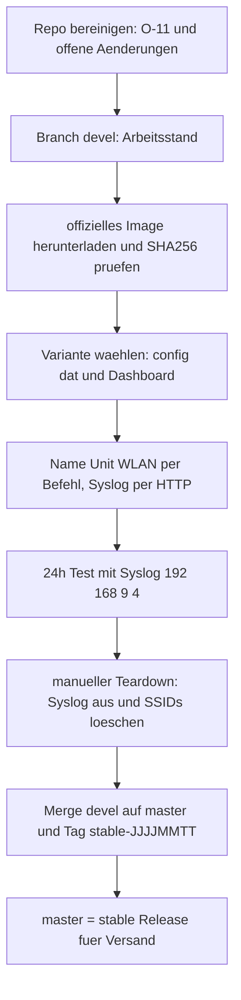
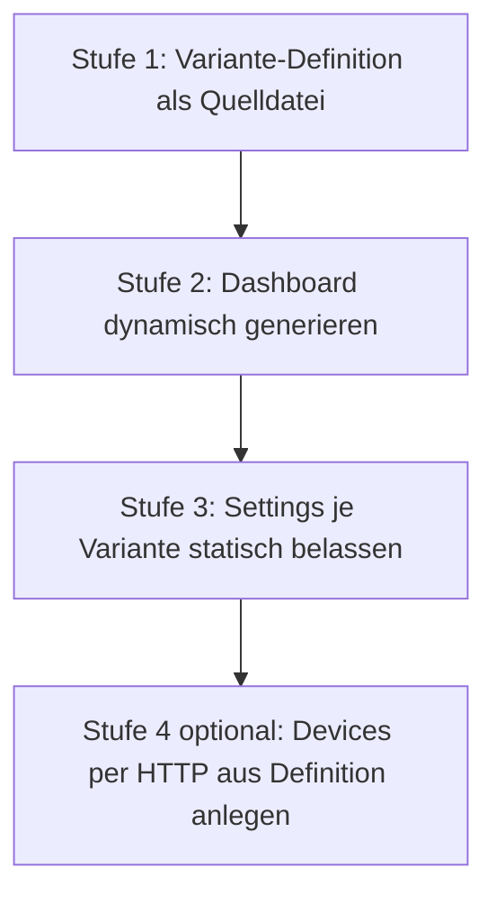
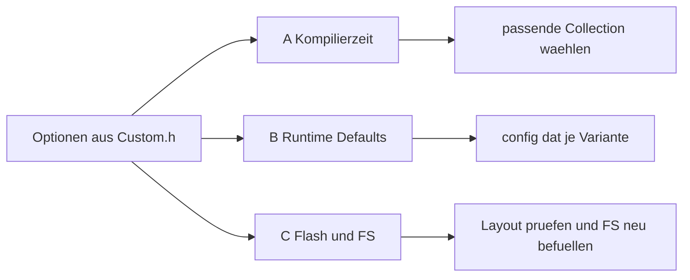
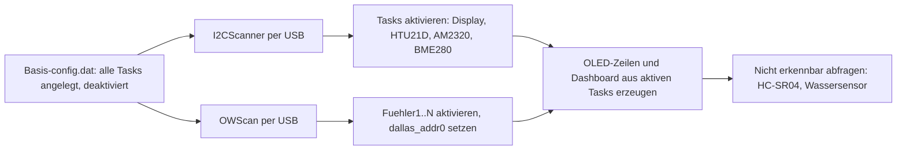
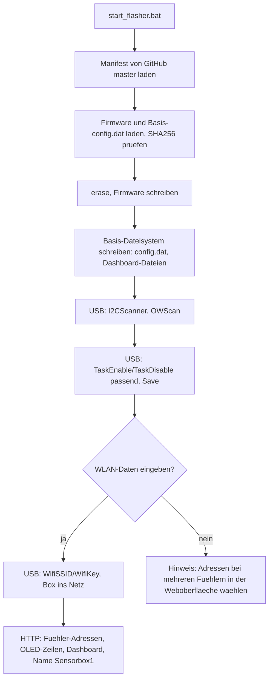

# Plan: Stable/Devel-Workflow mit offiziellen ESPEasy-Fertig-Images

**Status:** Entwurf v6 — v5 gegen das Repo gegengeprüft. Korrigiert: Abschnitt 3
(kein Submodul, `build/Wled/WLED` existiert nicht, Dateimodus-Bereinigung
ergänzt) und Abschnitt 1.1 (`3_hut21/readme.txt` ist nur Minimalbeispiel).
A2 (ETH) und T1 (Syslog) sind geklärt, Image-Wahl für Wemos korrigiert,
Sicherheitsbefund O-11 neu. Verbleibende Prüfpunkte in Abschnitt 7.
**Ergebnis dieser Aufgabe:** [`AGENTS.md`](../AGENTS.md) + dieser Plan.
Umsetzung (Skripte) als separate Aufgabe.

---

## 0. Sofort-Befund (vor der Umsetzung erledigen) — O-11

- [`configs/espeasy/standalone/wemos_htu21d/backup_Sensorbox1_U0_Build20250430_20251013195526.tar`](../configs/espeasy/standalone/wemos_htu21d/)
  enthält eine `security.dat` mit **echten WLAN-Zugangsdaten** und liegt im
  **öffentlichen** GitHub-Repo (seit Commit `57740343`).
- Die vier Tars in [`configs/espeasy/professional/3_hut21/`](../configs/espeasy/professional/3_hut21/)
  sind unkritisch (nur Defaults `ssid`/`wpakey`/`configesp`).
- **Maßnahmen:** betroffenen WLAN-Key rotieren (Pflicht, die Historie ist
  öffentlich), Tar aus dem Baum entfernen. Ein History-Rewrite bringt nach der
  Rotation wenig und ist optional.
- **Regel:** `security.dat` wird nie committet, außer sie enthält nachweislich
  nur Defaults (nach `esp_resetap`). Backup-Tars vor dem Commit prüfen.

---

## 1. Anforderungen

1. **Kein Eigenbuild mehr.** ESPEasy-Images als fertige Release-Binaries laden.
   Als Herkunftsnachweis dient eine `readme.txt` je Ordner. Das bestehende
   [`configs/espeasy/professional/3_hut21/readme.txt`](../configs/espeasy/professional/3_hut21/readme.txt)
   ist nur ein **Minimalbeispiel** (2 Zeilen, nennt nur Image-Name und
   Begründung) — der Ziel-Standard (Release-Tag, Asset, SHA256, Testdatum) ist
   in Abschnitt 3 definiert und noch nicht umgesetzt.
2. **Zwei Varianten, zwei Images:** Professional (ESP32, **ETH**) und
   Wemos/Standalone (ESP8266 4M1M).
3. **Stable/Devel als Git-Branches:** `devel` = Entwicklung (hier wird
   **heruntergeladen**, angepasst, getestet), **`master` = Stable**. Merge
   `devel` → `master` erst nach bestandenem Test. **Downloads ausschließlich
   auf `devel`.**
   `master` wird bewusst **nicht** in `main` umbenannt: das Dashboard
   ([`footer.txt`](../configs/espeasy/resources/footer.txt), auf allen
   ausgelieferten Boxen), die README und die oh-flasher-Readme verlinken
   `…/master/…`.
4. **`config.dat` je Variante** (Anzahl Fühler, verbaute Zusatzhardware wie
   Display/Wassersensor) statt Flasher-Presets — als Stable-Build beschickbar.
5. **WLAN und Syslog-IP NIE in einer Release-Datei**, sondern immer per
   Befehl bzw. Skript setzen und löschen. Präzisierung:
   - WLAN-SSID/Key liegen in ESPEasy in **`security.dat`**, nicht in
     `config.dat` → Releases enthalten **keine** `security.dat`.
   - Syslog-IP/-Level liegen in **`config.dat`** → in der Stable-`config.dat`
     leer bzw. aus.
   - Für Syslog gibt es **kein** ESPEasy-Kommando → Setzen/Löschen per
     HTTP an `/advanced` (Abschnitt 6).
6. **24h-Test mit Syslog auf 192.168.9.4**, danach manuell gestartetes
   Teardown: Syslog aus, bei WLAN-Boxen SSIDs löschen (wie `esp_resetap`).
7. **DS18B20-Adressautomatisierung** (Reiter Devices) — soweit möglich.
8. **Überlegung:** statische Config-Ordner vs. dynamisch generierte
   Settings/Dashboard → Abschnitt 4.

---

## 2. Recherche-Ergebnis: Download-Quelle und verfügbare Images

**Quelle:** GitHub Releases von `letscontrolit/ESPEasy`
(<https://github.com/letscontrolit/ESPEasy/releases>).

- **Neuestes Release:** Tag `mega-20260720`, veröffentlicht 2026-07-20
  (Vorgänger u. a. `mega-20260125` = `mega-20260121 (20260108-hotfix)` — das
  ist der Stand des bereits vorhandenen Professional-Images
  [`ESP_Easy_mega_20260121_collection_A_ESP32_4M316k.bin`](../configs/espeasy/professional/ESP_Easy_mega_20260121_collection_A_ESP32_4M316k.bin)).
- **Download-URL-Muster:**
  `https://github.com/letscontrolit/ESPEasy/releases/download/<TAG>/<ASSET>`
- **Relevante Assets:**
  - `ESPEasy_mega_<TAG>_ESP32_binaries.zip` → ESP32-Images (4M316k u. a.)
  - `ESPEasy_mega_<TAG>_ESP82xx_binaries.zip` → ESP8266-Images (4M1M u. a.)
  - `ESPEasy_mega_docs_<TAG>.zip` → Doku
  - weitere Chips (ESP32c2/c3/c5/c6/p4/s2/s3/solo1) — nicht benötigt

**Enthaltene ESP32-Images (4M316k, Auswahl):** `collection_A`–`collection_H`,
`climate_A/B`, `display_A/B`, `energy`, `neopixel`, `normal`, `custom`,
`custom_ESP32_4M2M_NO_OTA`, `max` (16M8M), jeweils als `.bin` + `.factory.bin`
(+ `IRExt`-Varianten).

**Ethernet (A2 erledigt):** Es gibt kein separates ETH-Image, weil Ethernet
bereits eingebaut ist: `env:collection_A_ESP32_4M316k` erbt in
`platformio_esp32_envs.ini` von `[esp32_common_LittleFS_ETH]` mit
`-DFEATURE_ETHERNET=1`. Das gilt auch für `collection_B`–`H`, `normal`,
`climate`, `energy`, `neopixel`, `max` — **nicht** für `display_A`.

**Enthaltene ESP8266-Images (4M1M, Auswahl):** `collection_A`–`collection_H`
(+ `_VCC`), `climate_A/B`, `display_A/B`, `energy`, `neopixel`, `normal`,
`custom_312_ESP8266_4M1M`, `custom_274_*`, `custom_beta_*`.

**Achtung `custom_312_ESP8266_4M1M`:** Der Env-Name ist derselbe wie im alten
[`build_release.sh`](../build/ESPEasy/build_release.sh), der **Inhalt aber
nicht**. Im CI fehlt eure Custom.h; die Plugin-Liste kommt aus
`tools/pio/pre_custom_esp82xx.py`: P001, P002, P003, P004, P026, P027, P028,
P033, P036, P037, P045, P049, P052, P056, P081, P082, Plugin-Stats/Chart.js
**aus**. Es fehlen u. a. **P005, P013 (HC-SR04), P014 (HTU21D), P023, P029,
P031, P051 (AM2320), P089, P145** → für `wemos_hcsr04`, `wemos_htu21d`,
`wemos_am2320*` unbrauchbar (O-12).

**Empfohlene Image-Wahl:**

| Geräteklasse | Image | Begründung |
|---|---|---|
| Professional (ESP32) | `ESP_Easy_mega_<TAG>_collection_A_ESP32_4M316k.factory.bin` | bereits in Produktion (3_hut21), enthält Zabbix (C017), DS18B20, HTU21, **Ethernet** |
| Wemos (ESP8266) | `ESP_Easy_mega_<TAG>_collection_A_ESP8266_4M1M.bin` | Stable-Set + Collection-Set: P004, P014, P028, P029, P031, P033, P036, P037, P051, P089, C005. **Kein C017** (nur `#ifdef ESP32`), **kein N001** (in ESP8266-Collections `#undef`). P005/P013/P145 und Stats in A1 prüfen |

---

## 3. Branch-Modell und Release-Fluss

**Vor dem Anlegen von `devel`** den Working Tree bereinigen:

- gelöschtes `configs/espeasy/standalone/2Sensoren/push_config.sh`,
- **Dateimodus-Änderungen** an den Skripten (`100755 => 100644`, u. a. alle
  `*.sh` und `build/ESPEasy/releases/release`). Rechte wiederherstellen mit
  `git diff --summary | grep "100755 => 100644" | sed 's/.*100644 //' | tr '\n' '\0' | xargs -0 chmod +x`
  (oder `git config core.fileMode false`, falls das Verzeichnis auf einem
  Dateisystem ohne Unix-Rechte liegt),
- verschachteltes Git-Repo `build/Tasmota/Tasmota` (eigenes `.git/`, **kein**
  Submodul — es gibt keine `.gitmodules`). `build/Wled/WLED` existiert **nicht**
  (per `build/Wled/.gitignore` ignoriert).

**Stable-Release-Ordner (versandfertig) enthält:**
1. das freigegebene `ESP_Easy_mega_*.bin`,
2. die `config.dat` der jeweiligen Variante (**ohne** Syslog-IP, erzeugt mit
   genau diesem Image-Tag), **keine** `security.dat`,
3. Dashboard (`openandhome.esp`, Icons, CSS),
4. `readme.txt` mit **Release-Tag, Asset-Name, SHA256**, Collection, Testdatum,
   Flash-Adressen/Aliasen und den Kommandos für Name/Unit, WLAN, Syslog und
   Admin-Passwort (`password`).

**Versionsbindung:** `config.dat` ist abwärts-, aber nicht vorwärtskompatibel.
Eine `config.dat` wird immer zusammen mit dem Image-Tag abgelegt, mit dem sie
getestet wurde.

**Repo-Größe:** `.git` hat bereits ~700 MB. Weil `devel` nach `master`
gemergt wird, bleibt jeder Download dauerhaft in der Historie. Deshalb pro
Geräteklasse nur **ein** aktuelles Image im Baum halten, Stände per Tag
(`stable-JJJJMMTT`) wiederfinden und Altlasten aufräumen (`esp32.bin.20251021`,
`spiffs*.bin` in ESP32-Ordnern). Git LFS ist eine Option, aber nicht
erforderlich.

Die alten Flasher-Presets (`tools/oh-flasher/firmware/N_spiffs1M.bin`) bleiben
zunächst bestehen, werden aber durch `config.dat`-Sets ersetzt (O-8).

---

## 4. Varianten-Modell: statisch oder dynamisch generieren?

### 4.1 Aufteilung: was gehört wohin?

| Inhalt | Wo | Begründung |
|---|---|---|
| Anzahl/Art Fühler, Display, Wassersensor (Tasks/Devices) | **`config.dat` je Variante** | gerätespezifisch, stabil |
| Delay, MQTT/Controller, NTP, Regeln, IP-Filter, I2C-Pins, Log-Levels | **`config.dat` je Variante** | produktbezogen |
| Netzwerk Professional (ETH-PHY, Pins, Network-Medium) | **`config.dat` Professional** | Soll-Werte: [`settings_lan_i2c.png`](../configs/espeasy/professional/settings_lan_i2c.png) |
| **Gerätename/Unit-Nr.** | **per Befehl** (`Name`, `Unit`, `Save`) | je Box eindeutig, sonst Kollision in MQTT (`%sysname%`) und Syslog |
| **WLAN SSID/Key** | **nur per Befehl** (`WifiSSID`, `WifiKey`, `Save`, `reboot`) → `security.dat` | ortsabhängig, gehört nicht ins Release |
| **Syslog-IP/Level** | **nur per HTTP `/advanced`** (Testmodus an/aus) | kein Kommando vorhanden, O-9 |
| **DS18B20-Adressen** | **je Box** (Abschnitt 8) | Adressen sind hardwareindividuell |
| Dashboard-Tabelle | **generiert** aus derselben Variante-Definition | muss immer zum Task-Set passen |

### 4.2 Drei Ansätze im Vergleich

| | **A — wie bisher:** Ordner je Variante mit fester `config.dat` | **B — dynamisch:** Variante-Definition als Quelle, Generator erzeugt Dashboard **und** Settings-Prüfung | **C — binär:** `config.dat` aus Template programmatisch patchen |
|---|---|---|---|
| Aufwand | gering | mittel | hoch |
| Dashboard ↔ Settings synchron | manuell, droht Drift | garantiert | nein |
| Risiko | viele Duplikate (1/3/4/5/6-Sensor-Ordner) | HTTP-API/Session nötig | Struktur/Checksumme ändert sich mit jeder ESPEasy-Version |
| Empfehlung | als Basis behalten | **Zielmodell** | verwerfen |

### 4.3 Empfohlener stufenweiser Weg

- **Stufe 1:** pro Variante eine kleine Textdatei (`variant.conf`/YAML):
  `name`, `fuehler=3`, `fuehler_typ=ds18b20`, `display=oled`, `wasser=ja`,
  `mqtt=ja`.
- **Stufe 2:** Generator ersetzt das manuelle `table.txt`-Pflegen →
  `header.txt` + generierte Tabelle + `footer.txt` → `openandhome.esp`
  (Muster wie [`push_config.sh`](../configs/espeasy/standalone/resources/push_config.sh)).
- **Stufe 3:** weiterhin **eine geprüfte `config.dat` je Variante**
  (binär, versionsgebunden); der Generator prüft nur die Namensübereinstimmung
  Task ↔ Dashboard (`[Fuehler1#Temperatur]` …).
- **Stufe 4 (optional, zu prüfen):** Devices automatisiert per HTTP-POST an
  `/devices` aus der Variante-Definition anlegen → entfällt Pflegen mehrerer
  `config.dat` (Voraussetzungen: Login/Passwort, stabile Formularparameter,
  O-10). Dieselbe Technik wird für die DS18B20-Adressen ohnehin gebraucht
  (Abschnitt 8, D-2).

**Verworfen:** ESPEasy-Kommando `provision` (Dateien von einem
Provisioning-Server laden) — `FEATURE_CUSTOM_PROVISIONING` ist nur in
MAX-Builds aktiv, nicht in `collection_A`.

**Kurzantwort:** Dashboard dynamisch generieren lohnt sich sofort. Settings
dynamisch zu generieren ist erst Stufe 4 — bis dahin bleibt `config.dat` je
Variante die verlässliche Basis.

---

## 5. Analyse der alten Build-Optionen (Custom.h) — drei Kategorien

Quelle: [`build/ESPEasy/myfiles/Custom.hESPEasy`](../build/ESPEasy/myfiles/Custom.hESPEasy).

### Kategorie A — Kompilierzeit, nur über die Image-Wahl abbildbar

| Option | Absicht | Übertragung |
|---|---|---|
| `PLUGIN_SET_NONE` + `USES_P001,P004,P005,P013,P014,P023,P026,P028,P029,P031,P033,P036,P037,P051,P089,P145` | nur benötigte Plugins | Collection-Wahl. `collection_A` enthält P004, P014, P028, P029, P031, P033, P036, P037, P051, P089 (ESP32 + ESP8266). **P145 nur in Collection F** → klären, ob P145 gebraucht wird. P005/P013/P023 in A1 prüfen |
| `CONTROLLER_SET_NONE` + `USES_C001`–`C018`, u. a. C005 HA-MQTT und **C017 Zabbix** | alle Controller inkl. Zabbix | C005 im Stable-Set; **C017 nur ESP32** (Collection-Controller-Set, `#ifdef ESP32`) |
| `USES_N001` | Email-Notifier | ESP32-Collection ja; **ESP8266-Collection nein** (`#undef USES_N001`) |
| `FEATURE_ESPEASY_P2P = 0`, `FEATURE_ARDUINO_OTA = 0` | Platz sparen | Fertig-Image hat es i. d. R. an → tolerieren (O-3) |
| `FEATURE_PLUGIN_STATS`, `PLUGIN_STATS_NR_ELEMENTS 16/64`, `FEATURE_CHART_JS`, `FEATURE_RULES_EASY_COLOR_CODE` | Historiendaten, Charts, Rules-Highlighting | ESP32 vorhanden; ESP8266-Collection in A1 prüfen |
| `BUILD_GIT` / `BUILD_NOTES` Branding | Kennzeichnung | entfällt; Ersatz: readme.txt je Ordner |
| UI-Flags (`MAIN_PAGE_SHOW_*`, `MENU_INDEX_*`, `SHOW_SYSINFO_JSON`) | Startseite/Systeminfo | Rest tolerieren |
| **Patches 0001–0007** ([`build/ESPEasy/myfiles/`](../build/ESPEasy/myfiles/)) | AP-Mode als Daily-Driver, `ApDontForceSetup`, „Sensor ohne WLAN nutzbar" | **nicht in Fertig-Images** → Schritt A3, Risiko O-1. Upstream-Kommando `wifiallowap` als möglichen Ersatz prüfen |

### Kategorie B — Runtime-Defaults → `config.dat` je Variante

| Setting | Sollwert | Bemerkung |
|---|---|---|
| `DEFAULT_NAME`, `DEFAULT_DELAY` | `Sensorbox1`, `1800` s | Name wird je Box per `Name`-Kommando überschrieben |
| Controller/Protocol/Port/Server | `true`/`5`/`1883`/`openandhome-server1`/DNS | Variante |
| `DEFAULT_PUB`/`DEFAULT_SUB` | `openandhome/%sysname%/…` | Variante |
| `DEFAULT_MQTT_RETAIN` | `false` | Variante |
| IP-Filter | `192.168.0.0`–`192.168.255.255`, Blocklevel `0` | Variante |
| `DEFAULT_USE_RULES`, NTP (Host `192.168.178.1`, TZ `60`, DST) | an | Variante |
| WLAN (Hidden-SSID, NoSleep) | an | Flags in `config.dat`; **Zugangsdaten stehen in `security.dat` und kommen nie ins Release** |
| Log-Level Serial/Web | INFO | Variante |
| **Syslog-IP/Level** | **leer/aus in Stable** | **nur per HTTP `/advanced` im Test setzen** |
| I2C ESP32 | SDA `13`, SCL `16` | Variante Professional |
| ETH ESP32 | PHY-Typ, MDC/MDIO/Power-Pins, Network-Medium | Variante Professional (Screenshot `settings_lan_i2c.png`) |
| `DEFAULT_ApDontForceSetup` | `true` | setzt Patch voraus → O-1 |

### Kategorie C — Flash-Layout und Filesystem

| | Professional (ESP32, ETH) | Wemos/Standalone (ESP8266) |
|---|---|---|
| Image | `…_collection_A_ESP32_4M316k.factory.bin` | `…_collection_A_ESP8266_4M1M.bin` |
| App @ | `0x000000` (factory) | `0x000000` |
| FS @ | `0x3B1000`, `0x4F000` ([Partition-CSV](../configs/espeasy/professional/esp32_partition_app1810k_spiffs316k.csv)) | `0x300000`, `0x100000` |
| FS-Typ | **LittleFS** | **SPIFFS** (ESP8266-4M1M-Envs; LittleFS nur bei Envs mit „LittleFS" im Namen) |
| Aliase | `esp32_flash_writefull`, `esp32_flash_write`, `esp_resetflash` | `esp_flashstable_min`, `esp_flash_write`, `esp_blank`, `esp_resetflash` |

Dashboard/Icons/CSS/`config.dat` per Web-Upload spielen
([`push_config.sh`](../configs/espeasy/standalone/resources/push_config.sh)).
Beim ESP32 umgeht das die LittleFS-/SPIFFS-Inkompatibilität alter
`spiffs316k.bin`. Beim ESP8266 sind alte `spiffs1M.bin` grundsätzlich noch
möglich, werden aber trotzdem durch den Upload-Weg ersetzt (eine Quelle für
beide Geräteklassen).

**Warum kein LittleFS bei den WLAN-Boxen (ESP8266)?** Der Grund ist keine eigene
Entscheidung, sondern das Release-Angebot:
- In `platformio_esp82xx_envs.ini` wird LittleFS nur über „LittleFS" im
  Env-Namen gewählt. Das einzige aktive ESP8266-LittleFS-Env ist
  **`custom_312_ESP8266_4M2M_LittleFS`**. Ein 16M-LittleFS-Env ist
  auskommentiert. Alle 4M1M-Envs (collection, normal, climate, display …)
  schließen `LittleFS(esp8266)` per `lib_ignore` sogar aus.
- Das 4M2M-LittleFS-Image passt nicht zu euch: Es ist ein **custom-Build**
  (gleiche reduzierte Plugin-Liste wie `custom_312`, ohne P013/P014/P051) und
  hat ein **anderes Layout** (2 MB FS statt 1 MB @0x300000). Damit wären
  Aliase, oh-flasher und `blank_4MB`-Prozedur anzupassen.
- Eine collection-Variante mit LittleFS für 4M1M gibt es nur per Eigenbuild,
  und das widerspricht Anforderung 1.
- Ein Wechsel SPIFFS → LittleFS formatiert das Dateisystem neu. Bestehende
  Boxen verlieren dabei per OTA `config.dat`/`security.dat` und müssen neu
  eingerichtet werden.

Fazit: Bei ESP8266 bleibt es bei SPIFFS, solange ESPEasy keine 4M1M-LittleFS-
Collection veröffentlicht. Bei jedem neuen Release-Tag prüfen (Teil von D1).
Durch den Upload-Weg betrifft das den Ablauf nicht.

---

## 6. Testverfahren (Devel, ca. 24 Stunden)

**Teststart**
1. Image flashen, `config.dat` + Dashboard per Upload (Syslog noch nicht drin).
2. Eindeutige Identität: `Name,<box>` → `Unit,<n>` → `Save`.
3. Professional: Netzwerk über ETH prüfen (ggf. `ethwifimode`, `ethip`).
   WLAN-Boxen: `WifiSSID …` → `WifiKey …` → `Save` → `reboot`
   (Alias `esp_sendap*`).
4. DS18B20-Adressen zuordnen (Abschnitt 8).
5. **Syslog per HTTP** auf `192.168.9.4`: ESPEasy hat **kein** Syslog-Kommando
   (geprüft in `src/src/Commands/InternalCommands.cpp`). Syslog-IP und -Level
   stehen auf **Tools → Advanced** (`/advanced`). Skript: Formular per GET
   lesen, nur Syslog-IP und Syslog-Level ändern, **alle übrigen Felder
   unverändert** zurück-POSTen. Sonst setzt ESPEasy fehlende Checkboxen auf
   „aus".
6. Am Syslogserver prüfen, dass die Box unter ihrem Namen erscheint.

**Was geloggt/geprüft wird:** Boot/Reset-Zyklen, WLAN-/ETH, MQTT (C005),
NTP, Sensorwerte (DS18B20, HTU21, AM2320, HCSR04), Regeln/Events,
Speicherverschleiß (`ResetFlashWriteCounter`), Dashboard.

**Teardown (nach ~24 h, manuell gestartet)**
1. Syslog per HTTP `/advanced` abschalten (Syslog-IP leer, Level wie Stable).
   Kein erneutes Spielen der Stable-`config.dat` — das würde Namen und
   DS18B20-Adressen überschreiben.
2. Nur bei WLAN-Boxen SSIDs löschen wie `esp_resetap`:
   `WifiSSID ssid` → `WifiKey wpakey` → `WifiSSID2 ssid` → `WifiKey2 wpakey`
   → `Save` → `reboot`.
3. Admin-Passwort auf Auslieferungsstand (`password`, wie ohtoolbox
   „Reset Admin").
4. **Verifikation:** kein Syslog-Traffic, SSIDs gelöscht, AP öffnet sich;
   eine eventuell gezogene Backup-`security.dat` enthält nur Defaults.
5. Ergebnis in `readme.txt` des Testordners → Merge-Freigabe.

**Werkzeuge — umgesetzt:** interne Funktionen liegen im Linux-Werkstatt-Tool
[`tools/ohwerkstatt/oh_werkstatt.sh`](../tools/ohwerkstatt/oh_werkstatt.sh):
Name/Unit, `OWScan`, Syslog an/aus/Status, Teardown, `config.dat`-Prüfung,
Image-Download, Monitor. Standardweg ist **USB**; nur Syslog geht per HTTP,
die Box-IP liest das Tool dabei per USB (`Settings`) aus.
Die [`ohtoolbox`](../tools/ohtoolbox/bin/linux_ohtoolbox.sh) ist für
Endkunden und bleibt unverändert (WLAN setzen/löschen, Reboot, AP-Mode …).
Getestet am 2026-11-11 an einer Testbox (ESP8266, 192.168.2.59): Syslog
an/aus, Name/Unit, IP per USB, `OWScan` (ohne Fühler, leere Antwort).

**Seriell-Hinweis:** Nach dem Öffnen des Ports steht oft Datenmüll im
Eingabepuffer des Sensors; das erste Kommando wird dann verworfen
(„Command unknown"). Vor Kommandos immer eine Leerzeile senden.
`Settings` gibt den WLAN-Key im Klartext aus — Ausgaben nicht in Tickets
oder Logs übernehmen.

---

## 7. Verbleibende Recherche-Checkliste (manuell ausführen)

| Nr. | Prüfpunkt | So prüfen | Status |
|---|---|---|---|
| **A1** | Plugins/Controller je Image | Geprüft an den Images `mega-20260720` (Plugin-Namen im Binary): **beide** enthalten P001, P004, P005, P013, P014, P023, P028, P031, P033, P036, P037, P051, P089; ESP32 zusätzlich Zabbix (C017) und Email (N001). **P145 (MQxxx) fehlt in beiden** → klären, ob eine Variante P145 nutzt. Plugin-Stats/Chart.js (ESP8266) nach dem Flashen ansehen | **erledigt** bis auf P145 |
| **A2** | Ethernet im ESP32-Image | `collection_A_ESP32_4M316k` → `[esp32_common_LittleFS_ETH]` → `FEATURE_ETHERNET=1` | **erledigt** (LAN-Praxistest im 24h-Test) |
| **A3** | `ApDontForceSetup`-Verhalten upstream | ESPEasy-Quelle/Doku nach `ApDontForceSetup` durchsuchen; Kommando `wifiallowap` prüfen; sonst Workaround | offen |
| **T1** | Syslog-Kommando | kein Kommando vorhanden; Weg: HTTP `/advanced` | **erledigt** |
| **T2** | Formularfeldnamen von `/advanced` (Syslog-IP/-Level) und Verhalten bei Teil-POST | Felder `syslogip`, `syslog_log_level`; Speichern über verstecktes Feld `edit=1`. Vollständiger Formular-Rundlauf mit [`espeasy_syslog.py`](../tools/bin/espeasy_syslog.py) an der Testbox: übrige Felder unverändert | **erledigt** |
| **B3** | Syslog in vorhandenen `config.dat` | [`espeasy_configcheck.py`](../tools/bin/espeasy_configcheck.py): Syslog aktiv in `professional/7Sensoren`, `professional/future`, `standalone/wemos_a0_feuchtigkeit`, `standalone/wemos_d5_testboard` und im `3_hut21`-Backup-Tar → vor Stable-Freigabe neu sichern (Syslog aus) | offen |
| **S1** | P004 „Auto Select Sensor" | Checkbox existiert, funktioniert aber nur bei **1 Sensor pro GPIO** → am Testboard für 1-Fühler-Varianten verifizieren | teilweise |
| **D-2** | Devices/Adressen per HTTP-POST `/devices` setzen | Feldname des Adress-Selectors (`Dallas1WireHelper`) ermitteln, curl-Test gegen Testbox inkl. Login | offen |
| **O-6** | Download-URL-Muster | `https://github.com/letscontrolit/ESPEasy/releases/download/<TAG>/<ASSET>` | **erledigt** |

---

## 8. DS18B20-Adressautomatisierung (P004)

Befund aus `_P004_Dallas.ino`: Es gibt eine Checkbox **„Auto Select Sensor"**.
Sie funktioniert **nur bei einem Sensor pro GPIO**. Ein Kommando zum Setzen der
Adresse gibt es nicht; gespeichert wird nur über das Web-Formular. Ein Task
kann mehrere Sensoren tragen (über die Auswahl des Sensortyps). Seriell
liefert das Kommando **`owscan`** die gefundenen 1-Wire-Adressen.

| Option | Idee | Bewertung |
|---|---|---|
| **D-1** | „Auto Select Sensor" in der Variante-`config.dat` aktivieren | **nur 1-Fühler-Varianten** (bzw. 1 Fühler je GPIO) |
| **D-2** | Adressen per `owscan` lesen, per HTTP-POST an `/devices` je Task schreiben | **Weg für 3–8 Fühler** |
| **D-3** | Adresse in der Variante-`config.dat` festschreiben | Adressen gerätespezifisch → nur Referenz-Box, verwerfen |
| **D-4** | Serielles Kommando zur Adressvergabe | **existiert nicht** → verworfen |

**Fühler-Zuordnung (O-13):** Bei Mehrfach-Boxen muss festgelegt sein, welcher
physische Fühler „Fuehler1" … „FuehlerN" ist. Vorschlag: Fühler einzeln
anstecken und nach jedem Schritt `owscan` ausführen → Reihenfolge = Task-Nr.
Alternativ Fühler beschriften und die Zuordnung Adresse ↔ Label in der
`readme.txt` bzw. im Lieferschein festhalten. Ohne diese Regel liefert D-2 eine
zufällige Zuordnung.

Empfehlung: **1 Fühler → D-1; mehrere Fühler → `owscan` + Zuordnungsregel + D-2.**

### 8.1 Autokonfiguration (Ziel, Machbarkeit an Testbox geprüft 2026-11-11)

Anforderung: Beim Teststart sind alle Sensoren angeschlossen; die Box soll
Fühler, Display und andere Sensoren selbst erkennen. Rückfallebene: nur die
Anzahl DS18B20 angeben und den Rest in der Weboberfläche einstellen.

**Befund an der Testbox (ESP8266, Build 20240121):**
- `I2CScanner` per USB liefert die I2C-Adressen (`Found 0x3c` = OLED SSD1306,
  `Found 0x40` = HTU21D/SI70xx).
- `OWScan,<GPIO>` per USB liefert die 1-Wire-Adressen (ohne Fühler leer).
- Die Device-Seite `/devices?index=<Task>&page=1` ist ein normales Formular
  (POST auf dieselbe URL, `edit=1`). Relevante Felder: `TDE` (Task aktiv,
  Checkbox), `TDN` (Name), `taskdevicepin1` (GPIO), bei P004
  **`dallas_addr0`** (Auswahl aus den am Bus gefundenen Adressen), bei
  I2C-Plugins `i2c_addr`, beim OLED (P036) die Zeilen `pc_arg1..12`.
- Die vorhandene `config.dat` enthält bereits alle Tasks, nicht passende sind
  deaktiviert (Fuehler1–4 DS18B20 an GPIO0, HTU21D, OLED, HC-SR04).

**Konzept: eine Basis-`config.dat` je Geräteklasse statt vieler Varianten**

| Hardware | Erkennung |
|---|---|
| DS18B20 (Anzahl, Adressen) | `OWScan,<GPIO>` — automatisch |
| OLED SSD1306 (0x3C/0x3D) | `I2CScanner` — automatisch |
| HTU21D/SI70xx (0x40), AM2320 (0x5C), BMx280 (0x76/0x77) | `I2CScanner` — automatisch |
| HC-SR04, Wassersensor (GPIO/analog) | **nicht erkennbar** → Abfrage j/n im Werkstatt-Tool |

**Zuordnung Fühler ↔ Task:** `OWScan` liefert die Adressen in
Bus-Suchreihenfolge (nach Adresse sortiert), nicht nach Steckplatz. Soll
„Fuehler1" ein bestimmter physischer Fühler sein, Fühler beschriften oder
nacheinander anstecken (O-13). Sonst gilt: Reihenfolge = Scan-Reihenfolge.

**Umgesetzt:** [`tools/bin/espeasy_autoconfig.py`](../tools/bin/espeasy_autoconfig.py)
(Werkstatt-Menü Punkt `a`). Ohne `--anwenden` nur Anzeige der Änderungen.
Getestet am 2026-11-11 an der Testbox mit `mega-20260720`: HTU21D und OLED
ausgeschaltet → erkannt, eingeschaltet, OLED-Zeilen erzeugt, nach Reboot
erhalten. Die Feldnamen sind zwischen den Versionen nicht stabil
(`pconf_N` → `pconfigIndex_N`); deshalb schickt das Skript immer das
komplette Formular zurück.

**Offen (braucht DS18B20 an der Box):** Format der Optionswerte von
`dallas_addr0` und Abgleich mit der `OWScan`-Ausgabe (das Skript sucht die
gescannte Adresse im Optionstext und warnt, wenn sie fehlt); Verhalten bei
mehr Fühlern als vorbereiteten Tasks (Professional bis 8).

### 8.2 Erprobter Ablauf Neuflash (Testbox ESP8266, 2026-11-11)

1. Sicherung: kompletter Flash (`esptool read_flash 0 0x400000`, ~100 s) und
   `config.dat` über `http://<box>/download` — außerhalb des Repos ablegen
   (enthält WLAN-Daten).
2. `esptool erase_flash`, dann `write_flash -fs 4MB 0x0 <collection_A_ESP8266_4M1M.bin>`.
   Unter Linux funktioniert das `esptool.py` 3.0 aus
   `tools/oh-flasher/bin/pythonportable/Lib/site-packages` mit dem System-`pyserial`
   (`PYTHONPATH=… python3 -m esptool`).
3. WLAN per USB (`WifiSSID`, `WifiKey`, `Save`, `Reboot`).
4. **`ClearAccessBlock` per USB**, wenn der Werkstatt-PC in einem anderen
   Subnetz liegt: eine frisch geflashte Box erlaubt Web-Zugriffe nur aus dem
   eigenen Subnetz (sonst „403 IP blocked").
5. Basis-`config.dat` per HTTP-Upload (`/upload`, multipart), `Reboot`.
   Eine `config.dat` aus Build 20240121 wurde von `mega-20260720` übernommen.
6. Autokonfiguration (8.1), dann Name/Unit, Syslog an → 24h-Test.

Automatisiert in [`tools/bin/espeasy_testbox.py`](../tools/bin/espeasy_testbox.py)
(Werkstatt-Menü 1–3), komplett an der Testbox durchlaufen am 2026-11-11.
Weitere Befunde:
- **Die IP-Sperre liegt in `security.dat`**, nicht in `config.dat` — der
  `config.dat`-Upload ändert sie nicht. `/json` ist von der Sperre ausgenommen,
  `/advanced`, `/config`, `/upload` nicht.
- **`ClearAccessBlock` + späteres `Save` schreibt „Allow All" fest.** Deshalb
  setzt der Ablauf nach Name/Unit und beim Testende den Zugriff explizit auf
  „Allow IP range" **192.168.0.0–192.168.255.255** (Config-Seite,
  `ipblocklevel=2`, `iprangelow`/`iprangehigh`).
- **Nach frischem Flash landete die Box im ersten Anlauf in einem anderen
  Netz** (192.168.6.x statt 192.168.2.x, gleiche SSID), nach Reboot korrekt.
  Der Ablauf startet bei Unerreichbarkeit bis zu 3× neu und fragt dann nach
  einer IP.
- **Namen:** im Test `Testbox<Unit>`, bei Auslieferung `Sensorbox1`/Unit 0.

**Sicherheitsbewertung IP-Bereich 192.168.0.0/16:** vertretbar. Der Filter ist
kein echter Schutz (jedes Gerät im Heimnetz 192.168.x kommt weiter auf die
Weboberfläche; Schutz gibt nur ein Admin-Passwort), sperrt aber Zugriffe aus
anderen Netzen. Nachteil: Kunden mit Heimnetz 10.x.x.x oder 172.16–31.x.x
erreichen die Weboberfläche nicht mehr — Abhilfe per ohtoolbox Punkt 9
(„Reset IP-Filtering"). Der alte Eigenbuild hatte „Allow All".

---

## 9. Umsetzungsschritte (To-Do für die spätere Ausführung)

1. **S0 — Sicherheitsbefund O-11 beheben** (Abschnitt 0): Key rotieren,
   Tar entfernen.
2. **W1 — Branch-Setup:** Working Tree bereinigen, `master` (stable) behalten,
   `devel` anlegen; Regel „nur `devel` darf Downloads enthalten"; Ordnerschema
   für Stable-/Test-Varianten; Tag-Schema `stable-JJJJMMTT`.
3. **R1 — Recherche-Checkliste (Abschnitt 7) abarbeiten:** A1 (ESP8266), A3,
   T2, S1, D-2; Ergebnisse in den Plan nachtragen.
4. **D1 — Download-Skript** — **umgesetzt:**
   [`tools/bin/espeasy_download.py`](../tools/bin/espeasy_download.py)
   (Python 3, keine Zusatzpakete). Läuft nur auf `devel`, holt das Release
   über die GitHub-API (`--tag`, Standard: neuestes), prüft die ZIPs gegen den
   GitHub-SHA256-Digest, legt pro Klasse genau ein `collection_A`-Image ab
   (alte per `git rm`), schreibt `readme_image.txt` (Tag, Asset, SHA256,
   Flash-Adressen) und meldet, falls ein 4M1M-LittleFS-Collection-Image
   erscheint. Erster Lauf: `mega-20260720` für beide Geräteklassen.
5. **B1 — Variante-Definition entwerfen:** `variant.conf`-Schema (Name, Fühler
   Anzahl/Typ, Display, Wasser, MQTT) als Quelle für Dashboard **und**
   Config-Prüfung (Stufe 1).
6. **B2 — Dashboard-Generator konzipieren:** Definition → `table.txt` →
   `openandhome.esp` (Stufe 2), Abgleich der Task-Namen mit der
   `config.dat` der Variante.
7. **B3 — `config.dat`-Sollwerte erfassen:** vorhandene
   [`configs/espeasy/professional/config.dat`](../configs/espeasy/professional/config.dat)
   und Standalone-`config.dat` gegen Abschnitt 5, Kategorie B;
   **Syslog-Werte entfernen**, ETH-Settings (Professional) und
   „Auto Select Sensor" (1-Fühler-Varianten) setzen; mit dem Ziel-Image-Tag
   neu speichern.
8. **C1 — Flash-Prozedur je Geräteklasse** formulieren (erase → App →
   `config.dat` + Dashboard-Upload → `Name`/`Unit` → WLAN-Kommandos →
   DS18B20 → Syslog (nur Test) → reboot).
9. **C2 — Verifikations-Checkliste** (Abschnitt 11) als readme-Vorlage.
10. **C3 — Aliase/Doku angleichen:** `esp32_flashstable*`/`esp_flashstable*`
    auf Fertig-Image-Namen umstellen, `goesp_build`/`goesp_release` als
    obsolet markieren, [`AGENTS.md`](../AGENTS.md) fortschreiben.
11. **C4 — Aufräumen:** alte Images/Backups in den Config-Ordnern
    (`esp32.bin.20251021`, `spiffs*.bin` in ESP32-Ordnern) nach Freigabe
    entfernen.

---

## 10. Offene Punkte und Risiken

| Nr. | Punkt | Risiko / Entscheidung | Status |
|---|---|---|---|
| O-1 | `ApDontForceSetup` / AP-Mode-as-Daily-Driver fehlen ggf. | Workaround (`wifiallowap`?) oder Akzeptanz | offen (A3) |
| O-2 | Ethernet der Professional-Box | in `collection_A_ESP32_4M316k` enthalten | **erledigt** (A2) |
| O-3 | `ESPEASY_P2P=0`/`ARDUINO_OTA=0` nicht abbildbar | tolerieren | akzeptiert |
| O-4 | Filesystem | ESP32 LittleFS (alte `spiffs316k.bin` inkompatibel), ESP8266 SPIFFS → beide per Upload | gelöst (Upload) |
| O-5 | `DEFAULT_*` greift nur bei Erstinit | immer `config.dat` mitspielen | gelöst |
| O-6 | Download-URL/Versionierung | — | **erledigt** (Abschnitt 2) |
| O-7 | DS18B20-Adresse ohne Auswahl | 1 Fühler: Auto Select; mehrere: `owscan` + D-2 | teilweise (S1, D-2) |
| O-8 | Windows-Flasher [`tools/oh-flasher/`](../tools/oh-flasher/Readme.md) | **wird umgestellt** (Entscheidung 2026-11-11) — Plan in Abschnitt 12 | geplant |
| O-9 | Syslog an/aus | kein Kommando → HTTP `/advanced` | gelöst, Feldnamen offen (T2) |
| O-10 | Dynamische Device-Erzeugung per HTTP (Stufe 4) | erst nach Prüfung der `/devices`-API entscheiden | offen (D-2) |
| **O-11** | WLAN-Schlüssel in Tar, Flash-Dumps, `spiffs1M.bin` (2Sensoren, 3Sensoren, 3Sensoren_Wasser, wemos_htu21d) und alten Tasmota-Skripten | Historie per `git filter-repo` bereinigt (2026-11-11, Binärdateien entfernt, Text → `***REMOVED***`); Force-Push und Key-Rotation stehen aus. Varianten 2Sensoren/3Sensoren/3Sensoren_Wasser haben dadurch keine Config mehr → von einer Box neu sichern (ohne `security.dat`) | Historie erledigt, Push/Rotation offen |
| **O-12** | Wemos-Image-Wahl | `custom_312` ungeeignet (fehlende Plugins) → `collection_A_ESP8266_4M1M` | **erledigt** (A1) |
| **O-13** | Fühler-Zuordnung physisch ↔ Task | Verfahren in Abschnitt 8 | offen |
| **O-14** | Repo-Größe durch Image-Historie | ein Image je Klasse im Baum, Tags, Aufräumen | offen |

---

## 11. Akzeptanzkriterien

- [`AGENTS.md`](../AGENTS.md) beschreibt Branch-Modell, beide Geräteklassen,
  Flash-Layouts, Varianten-/Config-Regeln, Testverfahren und Leitregeln.
- Keine `security.dat` mit Nicht-Default-Werten im Repo (O-11 erledigt).
- `devel` enthält ausschließlich neue Downloads/Änderungen; `master` nur
  getestete Stable-Stände mit readme.txt (Release-Tag, Asset, SHA256,
  Collection, Testdatum).
- Je Variante existieren `config.dat` (ohne Syslog, ohne `security.dat`)
  **und** ein passend generiertes Dashboard mit identischen Task-Namen.
- WLAN ist vollständig kommandogesteuert, Syslog vollständig per Skript/HTTP
  gesteuert (setzen **und** löschen), ohne Anfassen einer Config-Datei.
- Jede Testbox hat einen eindeutigen Namen/Unit.
- Teardown-Test: Syslog gestoppt, SSIDs gelöscht, AP öffnet sich
  (nur WLAN-Boxen).
- DS18B20: Adressvergabe ohne manuelle Auswahl im Reiter Devices
  (1 Fühler: Auto Select; mehrere: Skript + dokumentierte Zuordnung).

---

## 12. Windows-Flasher umstellen (O-8)

**Entscheidungen (2026-11-11):** Flasher wird umgestellt; er soll die
Konfiguration **automatisch erkennen** und alles **aus unserem Repo laden**.
**Nur Standalone (ESP8266)** — Professional-Kunden brauchen ihn nicht.

**Ist:** [`openandhome-flasher.ps1`](../tools/oh-flasher/bin/openandhome-flasher.ps1)
(PowerShell + portables Python 3.9 + esptool 3.0 + pyserial 3.5): Update
(nur Firmware), Löschen und Upgrade (Firmware + `N_spiffs1M.bin` nach
Auswahl der Fühleranzahl), Debug, je stable/devel. Danach wählt der Kunde die
DS18B20-Adressen von Hand. Alle Dateien liegen im ZIP (Eigenbuilds).

**Befund an der Testbox:** `TaskEnable,<n>` / `TaskDisable,<n>` + `Save` per
USB bleiben über einen Reboot erhalten → Sensoren lassen sich **ohne Netzwerk**
passend zur erkannten Hardware ein-/ausschalten. Nur DS18B20-Adressen bei
mehreren Fühlern, OLED-Zeilen und Dashboard brauchen HTTP.

### 12.1 Ablauf

### 12.2 Bausteine

| Nr. | Baustein | Inhalt |
|---|---|---|
| FL-1 | **Python statt PowerShell-Logik** | Kern als `tools/oh-flasher/bin/oh_flasher.py` (läuft mit dem mitgelieferten Python 3.9, esptool, pyserial). Die `.ps1` startet nur noch Python. Gleicher Code ist unter Linux testbar (an der Testbox). |
| FL-2 | **Manifest auf `master`** | `tools/oh-flasher/manifest.json`: Firmware-Datei, SHA256, Release-Tag, Basis-`config.dat`, Dashboard-Dateien, Erkennungsregeln. Geladen über `https://raw.githubusercontent.com/martament/openandhome/master/…` — damit bekommt der Kunde immer den **freigegebenen Stable-Stand**, nie `devel`. |
| FL-3 | **Offline-Rückfall** | Ist GitHub nicht erreichbar, nimmt der Flasher die im ZIP mitgelieferte Kopie (gleiche Struktur). |
| FL-4 | **Basis-Dateisystem** | Ein FS-Abzug (`0x300000`, Länge `0xFB000` — nicht die SDK-Sektoren dahinter, dort können WLAN-Daten liegen) aus einer getesteten Box im Auslieferungszustand: Basis-`config.dat` mit allen Tasks, Dashboard für alle Tasks, `security.dat` nur Defaults. Erzeugt per Werkstatt-Menü „Kundenpaket erzeugen"; vor dem Commit Prüfung auf WLAN-Daten. |
| FL-5 | **Erkennung über USB** | `I2CScanner` (0x3C Display, 0x40 HTU21D, 0x5C AM2320, 0x76/77 BMx280), `OWScan,<GPIO>` (Anzahl DS18B20); danach `TaskEnable`/`TaskDisable` + `Save`. Nicht erkennbar (HC-SR04, Wassersensor): Rückfrage j/n. Wiederverwendung der Logik aus `espeasy_autoconfig.py`. |
| FL-6 | **Optional WLAN** | Kunde kann WLAN-Daten eingeben (wie ohtoolbox Punkt 1). Dann läuft die vollständige Autoerkennung über HTTP: Fühler-Adressen, OLED-Zeilen, Dashboard nur mit vorhandenen Sensoren. Ohne WLAN: Box öffnet ihren AP wie bisher; bei 1 Fühler wählt P004 „Auto Select" die Adresse selbst, bei mehreren bleibt die Auswahl in der Weboberfläche. |
| FL-7 | **Menü** | 1 Sensor neu aufsetzen (Ablauf 12.1), 2 Nur Firmware aktualisieren (Einstellungen bleiben), 3 Debug, 4 Beenden. **devel-Optionen und `blank_4MB.bin` entfallen.** |
| FL-8 | **Aufräumen** | `tools/oh-flasher/firmware/` (Eigenbuilds, `N_spiffs1M.bin`) durch Manifest-Dateien ersetzen; Readme und Bilder anpassen; `oh-flasher.zip` als GitHub-Release neu bauen. |
| FL-9 | **Tests** | Linux: `oh_flasher.py` komplett an der Testbox (mit/ohne WLAN). Windows: Start über `start_flasher.bat`, COM-Port-Erkennung, Download — durch dich. |

### 12.3 Stand der Umsetzung (2026-11-11)

**Umgesetzt und an der Testbox getestet:**
- [`oh_flasher.py`](../tools/oh-flasher/bin/oh_flasher.py): Menü 1 Neu aufsetzen
  **mit WLAN** (Firmware, WLAN per USB, Basis-`config.dat` per HTTP,
  Autoerkennung, Dashboard, Zugriffsbereich) komplett durchgelaufen;
  Menü 2 Nur Firmware aus dem **entpackten ZIP im Offline-Modus** geprüft.
- [`openandhome-flasher.ps1`](../tools/oh-flasher/bin/openandhome-flasher.ps1) startet nur noch Python.
- Manifest per Werkstatt-Menü `k` ([`espeasy_testbox.py kundenpaket`](../tools/bin/espeasy_testbox.py)),
  ZIP per [`paket_bauen.py`](../tools/oh-flasher/paket_bauen.py) (`daten/` = Offline-Kopie).
- **Windows-Test steht aus** (Start, COM-Port, Download von GitHub).

**Befund – kein Dateisystem-Abzug von Boxen:** Ein Abzug (`read_flash
0x300000 0xFB000`) einer Box, deren WLAN vorher gelöscht wurde, enthielt
trotzdem den alten WLAN-Schlüssel. SPIFFS markiert überschriebene Seiten nur
als gelöscht. Der Abzug wurde sofort gelöscht (nie committet).
**Folge:** Der Weg **ohne WLAN** braucht ein frisch gebautes SPIFFS-Image
(`mkspiffs` aus der ESP8266-Toolchain, Seite 256, Block 8192, Größe `0xFB000`)
aus `config.dat` + Dashboard-Dateien, **ohne** `security.dat`. Das Herunterladen
und Ausführen von `mkspiffs` wurde in dieser Sitzung vom Auto-Modus blockiert
(fremdes Binary) — Freigabe durch Martin nötig. Bis dahin fragt der Flasher
nach WLAN und bricht ohne WLAN mit einem Hinweis ab.
- Alte Dateien in `tools/oh-flasher/firmware/` bleiben, bis der Offline-Weg steht.

**Offen:** Verhalten von P004 „Auto Select" mit echtem Fühler (Testbox hat
keinen DS18B20); Basis-`config.dat` braucht dafür „Auto Select" im ersten
DS18B20-Task.

---

## 13. Basis-config.dat Standalone: Anpassungen (2026-11-11)

Geprüft an der Testbox, umgesetzt in
[`configs/espeasy/standalone/basis/config.dat`](../configs/espeasy/standalone/basis/config.dat)
(Manifest neu erzeugt):

| Einstellung | vorher | jetzt | Grund |
|---|---|---|---|
| NTP-Server | `192.168.178.1` (eigene FritzBox) | `de.pool.ntp.org` | beim Kunden erreichbar |
| MQTT-Controller (C005 → `openandhome-server1`) | an | **aus** | Standalone ohne Server; Last sank von **100 % auf ~12 %**, freier RAM 7,4 → 9,6 KB |
| WLAN Force No Sleep | aus | an | war in `Custom.h` gesetzt; stabilere Verbindung (Netzteil) |
| WLAN Periodical Gratuitous ARP | aus | an | Router „vergessen" ruhige Geräte nicht |

Formulare: NTP auf `/advanced`, Controller `/controllers?index=1`, WLAN-Optionen
auf **`/network?index=1`** (`force_wifi_no_sleep`,
`periodical_send_gratuitous_arp`). Das WLAN-Passwortfeld liefert dort nur
`*****`; der Rundlauf lässt den gespeicherten Schlüssel unverändert (geprüft).
Speichern der Netzwerk-Seite baut die WLAN-Verbindung neu auf.
