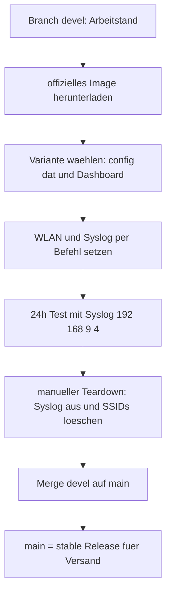
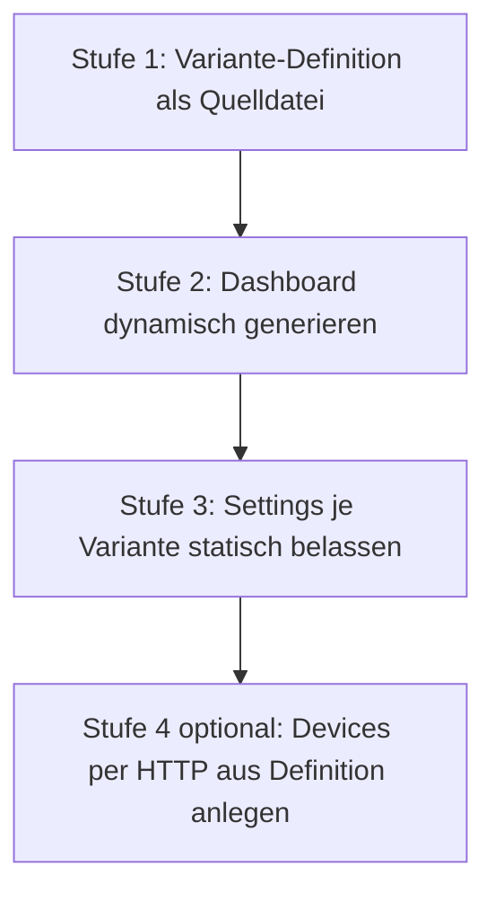
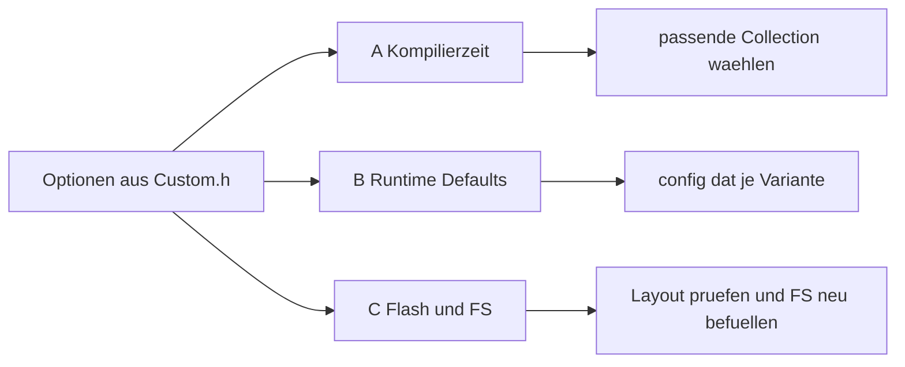
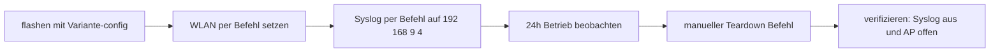

# Plan: Stable/Devel-Workflow mit offiziellen ESPEasy-Fertig-Images

**Status:** Entwurf v4 — mit Recherche-Ergebnissen zur Download-Quelle und
Image-Auswahl. Recherche abgeschlossen (siehe Abschnitt 2); verbleibende
Prüfpunkte sind in Abschnitt 7 als Checkliste festgehalten.
**Ergebnis dieser Aufgabe:** [`AGENTS.md`](../AGENTS.md) + dieser Plan.
Umsetzung (Skripte) als separate Aufgabe.

---

## 1. Anforderungen

1. **Kein Eigenbuild mehr.** ESPEasy-Images als fertige Release-Binaries laden
   (Vorbild: [`configs/espeasy/professional/3_hut21/readme.txt`](../configs/espeasy/professional/3_hut21/readme.txt)).
2. **Zwei Varianten, zwei Images:** Professional (ESP32, **ETH**) und
   Wemos/Standalone (ESP8266 4M1M).
3. **Stable/Devel als Git-Branches:** `devel` = Entwicklung (hier wird
   **heruntergeladen**, angepasst, getestet), `main` = Stable. Merge `devel` →
   `main` erst nach bestandenem Test. **Downloads ausschließlich auf `devel`.**
4. **`config.dat` je Variante** (Anzahl Fühler, verbaute Zusatzhardware wie
   Display/Wassersensor) statt Flasher-Presets — als Stable-Build beschickbar.
5. **WLAN und Syslog-IP NIE in der `config.dat`**, sondern immer per Befehl
   setzen und löschen.
6. **24h-Test mit Syslog auf 192.168.9.4**, danach manuell gestartetes
   Teardown: Syslog aus, bei WLAN-Boxen SSIDs löschen (wie `esp_resetap`).
7. **DS18B20-Adressautomatisierung** (Reiter Devices) — soweit möglich.
8. **Überlegung:** statische Config-Ordner vs. dynamisch generierte
   Settings/Dashboard → Abschnitt 4.

---

## 2. Recherche-Ergebnis: Download-Quelle und verfügbare Images

**Quelle:** GitHub Releases von `letscontrolit/ESPEasy`
(<https://github.com/letscontrolit/ESPEasy/releases>).

- **Neuestes Release:** Tag `mega-20260720`, veröffentlicht 2026-07-20
  (Vorgänger u. a. `mega-20260125` = `mega-20260121 (20260108-hotfix)` — das
  ist der Stand des bereits vorhandenen Professional-Images
  [`ESP_Easy_mega_20260121_collection_A_ESP32_4M316k.bin`](../configs/espeasy/professional/ESP_Easy_mega_20260121_collection_A_ESP32_4M316k.bin)).
- **Download-URL-Muster:**
  `https://github.com/letscontrolit/ESPEasy/releases/download/<TAG>/<ASSET>`
- **Relevante Assets:**
  - `ESPEasy_mega_<TAG>_ESP32_binaries.zip` → ESP32-Images (4M316k u. a.)
  - `ESPEasy_mega_<TAG>_ESP82xx_binaries.zip` → ESP8266-Images (4M1M u. a.)
  - `ESPEasy_mega_docs_<TAG>.zip` → Doku
  - weitere Chips (ESP32c2/c3/c5/c6/p4/s2/s3/solo1) — nicht benötigt

**Enthaltene ESP32-Images (4M316k, Auswahl):** `collection_A`–`collection_H`,
`climate_A/B`, `display_A/B`, `energy`, `neopixel`, `normal`, `custom`,
`custom_ESP32_4M2M_NO_OTA`, `max` (16M8M), jeweils als `.bin` + `.factory.bin`
(+ `IRExt`-Varianten). **Kein eigenes `ETH`-Image** in der Liste → O-2.

**Enthaltene ESP8266-Images (4M1M, Auswahl):** `collection_A`–`collection_H`
(+ `_VCC`), `climate_A/B`, `display_A/B`, `energy`, `neopixel`, `normal`,
**`custom_312_ESP8266_4M1M`** — exakt das Environment, das der alte
[`build_release.sh`](../build/ESPEasy/build_release.sh) für Standalone nutzte —
`custom_274_*`, `custom_beta_*`.

**Empfohlene Image-Wahl (vorläufig, Absicherung in Abschnitt 7):**

| Geräteklassе | Image | Begründung |
|---|---|---|
| Professional (ESP32) | `ESP_Easy_mega_<TAG>_collection_A_ESP32_4M316k.factory.bin` | bereits in Produktion (3_hut21), enthält Zabbix/DS18B20/HTU21 — **ETH-Unterstützung prüfen (O-2)** |
| Wemos (ESP8266) | `ESP_Easy_mega_<TAG>_custom_312_ESP8266_4M1M.bin` | entspricht exakt dem bisherigen Eigenbuild-Environment `custom_312_ESP8266_4M1M` |

---

## 3. Branch-Modell und Release-Fluss

**Stable-Release-Ordner (versandfertig) enthält:**
1. das freigegebene `ESP_Easy_mega_*.bin`,
2. die `config.dat` der jeweiligen Variante (**ohne** WLAN, **ohne** Syslog-IP),
3. Dashboard (`openandhome.esp`, Icons, CSS),
4. `readme.txt` mit Quelle/Version/Collection, Testdatum, Flash-Adresse/Aliasen
   und den Kommandos für WLAN- und Syslog-Setzung.

Die alten Flasher-Presets (`tools/oh-flasher/firmware/N_spiffs1M.bin`) bleiben
zunächst bestehen, werden aber durch `config.dat`-Sets ersetzt (O-8).

---

## 4. Varianten-Modell: statisch oder dynamisch generieren?

### 4.1 Aufteilung: was gehört wohin?

| Inhalt | Wo | Begründung |
|---|---|---|
| Anzahl/Art Fühler, Display, Wassersensor (Tasks/Devices) | **`config.dat` je Variante** | gerätespezifisch, stabil |
| Name, Delay, MQTT/Controller, NTP, Regeln, IP-Filter, I2C-Pins, Log-Levels | **`config.dat` je Variante** | produktbezogen |
| **WLAN SSID/Key** | **nur per Befehl** (`WifiSSID`, `WifiKey`, `Save`, `reboot`) | ortsabhängig, gehört nicht ins Release |
| **Syslog-IP/Level** | **nur per Befehl** (Testmodus an/aus) | testabhängig, O-9 |
| Dashboard-Tabelle | **generiert** aus derselben Variante-Definition | muss immer zum Task-Set passen |

### 4.2 Drei Ansätze im Vergleich

| | **A — wie bisher:** Ordner je Variante mit fester `config.dat` | **B — dynamisch:** Variante-Definition als Quelle, Generator erzeugt Dashboard **und** Settings-Prüfung | **C — binär:** `config.dat` aus Template programmatisch patchen |
|---|---|---|---|
| Aufwand | gering | mittel | hoch |
| Dashboard ↔ Settings synchron | manuell, droht Drift | garantiert | nein |
| Risiko | viele Duplikate (1/3/4/5/6-Sensor-Ordner) | HTTP-API/Session nötig | Struktur/Checksumme ändert sich mit jeder ESPEasy-Version |
| Empfehlung | als Basis behalten | **Zielmodell** | verwerfen |

### 4.3 Empfohlener stufenweiser Weg

- **Stufe 1:** pro Variante eine kleine Textdatei (`variant.conf`/YAML):
  `name`, `fuehler=3`, `fuehler_typ=ds18b20`, `display=oled`, `wasser=ja`,
  `mqtt=ja`.
- **Stufe 2:** Generator ersetzt das manuelle `table.txt`-Pflegen →
  `header.txt` + generierte Tabelle + `footer.txt` → `openandhome.esp`
  (Muster wie [`push_config.sh`](../configs/espeasy/standalone/resources/push_config.sh)).
- **Stufe 3:** weiterhin **eine geprüfte `config.dat` je Variante**
  (binär, versionsgebunden); der Generator prüft nur die Namensübereinstimmung
  Task ↔ Dashboard (`[Fuehler1#Temperatur]` …).
- **Stufe 4 (optional, zu prüfen):** Devices automatisiert per HTTP-POST an
  `/devices` aus der Variante-Definition anlegen → entfällt Pflegen mehrerer
  `config.dat` (Voraussetzungen: Login/Passwort, stabile Formularparameter,
  O-10).

**Kurzantwort:** Dashboard dynamisch generieren lohnt sich sofort. Settings
dynamisch zu generieren ist erst Stufe 4 — bis dahin bleibt `config.dat` je
Variante die verlässliche Basis.

---

## 5. Analyse der alten Build-Optionen (Custom.h) — drei Kategorien

Quelle: [`build/ESPEasy/myfiles/Custom.hESPEasy`](../build/ESPEasy/myfiles/Custom.hESPEasy).

### Kategorie A — Kompilierzeit, nur über die Image-Wahl abbildbar

| Option | Absicht | Übertragung |
|---|---|---|
| `PLUGIN_SET_NONE` + `USES_P001,P004,P005,P013,P014,P023,P026,P028,P029,P031,P033,P036,P037,P051,P089,P145` | nur benötigte Plugins | Collection-Wahl (Schritt A1) |
| `CONTROLLER_SET_NONE` + `USES_C001`–`C018`, u. a. C005 HA-MQTT und **C017 Zabbix** | alle Controller inkl. Zabbix | Collection muss C017 enthalten |
| `USES_N001` | Email-Notifier | Collection prüfen |
| `FEATURE_ESPEASY_P2P = 0`, `FEATURE_ARDUINO_OTA = 0` | Platz sparen | Fertig-Image hat es i. d. R. an → tolerieren (O-3) |
| `FEATURE_PLUGIN_STATS`, `PLUGIN_STATS_NR_ELEMENTS 16/64`, `FEATURE_CHART_JS`, `FEATURE_RULES_EASY_COLOR_CODE` | Historiendaten, Charts, Rules-Highlighting | in Standard-Images enthalten → Schritt A1 prüfen |
| `BUILD_GIT` / `BUILD_NOTES` Branding | Kennzeichnung | entfällt; Ersatz: readme.txt je Ordner |
| UI-Flags (`MAIN_PAGE_SHOW_*`, `MENU_INDEX_*`, `SHOW_SYSINFO_JSON`) | Startseite/Systeminfo | Rest tolerieren |
| **Patches 0001–0007** ([`build/ESPEasy/myfiles/`](../build/ESPEasy/myfiles/)) | AP-Mode als Daily-Driver, `ApDontForceSetup`, „Sensor ohne WLAN nutzbar" | **nicht in Fertig-Images** → Schritt A3, Risiko O-1 |

### Kategorie B — Runtime-Defaults → `config.dat` je Variante

| Setting | Sollwert | Bemerkung |
|---|---|---|
| `DEFAULT_NAME`, `DEFAULT_DELAY` | `Sensorbox1`, `1800` s | Variante |
| Controller/Protocol/Port/Server | `true`/`5`/`1883`/`openandhome-server1`/DNS | Variante |
| `DEFAULT_PUB`/`DEFAULT_SUB` | `openandhome/%sysname%/…` | Variante |
| `DEFAULT_MQTT_RETAIN` | `false` | Variante |
| IP-Filter | `192.168.0.0`–`192.168.255.255`, Blocklevel `0` | Variante |
| `DEFAULT_USE_RULES`, NTP (Host `192.168.178.1`, TZ `60`, DST) | an | Variante |
| WLAN (Hidden-SSID, NoSleep) | an | **Zugangsdaten kommen NIE aus der config.dat** |
| Log-Level Serial/Web | INFO | Variante |
| **Syslog-IP/Level** | **leer in Stable** | **nur per Befehl im Test setzen** |
| I2C ESP32 | SDA `13`, SCL `16` | Variante Professional |
| `DEFAULT_ApDontForceSetup` | `true` | setzt Patch voraus → O-1 |

### Kategorie C — Flash-Layout und Filesystem

| | Professional (ESP32, ETH) | Wemos/Standalone (ESP8266) |
|---|---|---|
| Image | `…_collection_A_ESP32_4M316k.factory.bin` (ETH prüfen → O-2) | `…_custom_312_ESP8266_4M1M.bin` |
| App @ | `0x000000` (factory) | `0x000000` |
| FS @ | `0x3B1000`, `0x4F000` ([Partition-CSV](../configs/espeasy/professional/esp32_partition_app1810k_spiffs316k.csv)) | `0x300000`, `0x100000` |
| FS-Typ | **LittleFS** | **LittleFS** |
| Aliase | `esp32_flash_writefull`, `esp32_flash_write`, `esp_resetflash` | `esp_flashstable_min`, `esp_flash_write`, `esp_blank`, `esp_resetflash` |

Dashboard/Icons/CSS per Web-Upload spielen
([`push_config.sh`](../configs/espeasy/standalone/resources/push_config.sh)) —
umgeht die LittleFS-/SPIFFS-Inkompatibilität alter `spiffs*.bin`.

---

## 6. Testverfahren (Devel, ca. 24 Stunden)

**Teststart**
1. Image + `config.dat` der Variante flashen (WLAN/Syslog noch nicht drin).
2. WLAN per Befehl: `WifiSSID …` → `WifiKey …` → `Save` → `reboot`
   (Alias `esp_sendap*`).
3. Syslog per Befehl auf `192.168.9.4` setzen (Kommando in Checkliste T1,
   sonst Web-UI Config-Page) und `Save`.
4. Am Syslogserver prüfen, dass die Box erscheint.

**Was geloggt/geprüft wird:** Boot/Reset-Zyklen, WLAN-/ETH, MQTT (C005),
NTP, Sensorwerte (DS18B20, HTU21, AM2320, HCSR04), Regeln/Events,
Speicherverschleiß (`ResetFlashWriteCounter`), Dashboard.

**Teardown (nach ~24 h, manuell gestartet)**
1. Syslog-Logging abschalten (Kommando bzw. Web-UI; Ziel: Syslog-IP leer,
   Level wie Stable) → `Save`.
2. Nur bei WLAN-Boxen SSIDs löschen wie `esp_resetap`:
   `WifiSSID ssid` → `WifiKey wpakey` → `WifiSSID2 ssid` → `WifiKey2 wpakey`
   → `Save` → `reboot`.
3. **Verifikation:** kein Syslog-Traffic, SSIDs gelöscht, AP öffnet sich.
4. Ergebnis in `readme.txt` des Testordners → Merge-Freigabe.

**Werkzeuge (Umsetzung später):** Erweiterung von
[`tools/ohtoolbox/bin/linux_ohtoolbox.sh`](tools/ohtoolbox/bin/linux_ohtoolbox.sh)
um „Syslog an/aus", „Teardown", „WLAN setzen/löschen"; bestehende Aliase
(`esp_sendap*`, `esp_resetap`, `esp_monitor`) bleiben gültig.

---

## 7. Verbleibende Recherche-Checkliste (manuell ausführen)

Die folgenden Punkte konnten ohne Geräte-/Quellenzugang nicht abschließend
geklärt werden und sind vor der Umsetzung zu verifizieren:

| Nr. | Prüfpunkt | So prüfen | Ergebnis eintragen in |
|---|---|---|---|
| **A1** | Enthält `collection_A` alle benötigten Plugins/Controller (P001, P004, P005, P013, P014, P023, P026, P028, P029, P031, P033, P036, P037, P051, P089, P145, C005, **C017 Zabbix**, N001)? | ESPEasy-Quelle `src/src/CustomBuild/define_plugin_sets.h` (mega-Branch) lesen **oder** nach dem Flashen unter Tools → SysInfo/Devices prüfen | Abschnitt 2, Tabelle Bildwahl |
| **A2** | Unterstützt das gewählte ESP32-Image **Ethernet** (kein separates ETH-Image im Release)? | `define_plugin_sets.h`/`platformio_esp32_envs.ini` auf `USE_ETHERNET`/ETH-Envs prüfen; praktisch: Professional-Box per LAN testen | O-2 |
| **A3** | Existiert `ApDontForceSetup`-Verhalten upstream (Setting/Build-Flag)? | ESPEasy-Quelle/Doku nach `ApDontForceSetup` durchsuchen; sonst Workaround | O-1 |
| **T1** | Exakte ESPEasy-Kommandos zum Setzen/Löschen der **Syslog-IP/Level** seriell | ESPEasy-Command-Liste (Wiki) bzw. am Gerät testen: `SyslogIP`/`SyslogLevel`-Kandidaten, sonst Web-UI Config-Page | Abschnitt 6, Teststart |
| **S1** | Verhalten von P004 (DS18B20) bei **leerer Adresse** — wird der erste gefundene Sensor genutzt? | Am Testboard: Device ohne Adresse anlegen, Verhalten beobachten. Wenn nein: Skript D-2 (HTTP-POST `/devices`) | Abschnitt 8 |
| **D-2** | Lassen sich Devices per HTTP-POST `/devices` zuverlässig anlegen (Login, Parameter)? | curl-Test gegen Testbox | Stufe 4, O-10 |
| **O-6** | Download-URL-Muster bestätigt | **erledigt** (Abschnitt 2): `https://github.com/letscontrolit/ESPEasy/releases/download/<TAG>/<ASSET>` | — |

---

## 8. DS18B20-Adressautomatisierung (P004)

| Option | Idee | Bewertung |
|---|---|---|
| **D-1** | Adresse leer lassen: P004 verwendet evtl. automatisch den ersten gefundenen Sensor | **zuerst testen** (S1) |
| **D-2** | Skript liest gefundene Adressen aus (Web-UI-Dropdown/Syslog) und schreibt die erste per HTTP-POST an `/devices` | robusteste Automatisierung |
| **D-3** | Adresse in der Variante-`config.dat` festschreiben | nur bei identischer Bus-Belegung; Adressen gerätespezifisch → risikoreich |
| **D-4** | Serielles Kommando zur Adressvergabe | in S1 mit prüfen |

Empfehlung: **S1 (D-1 testen) → bei Misserfolg D-2.**

---

## 9. Umsetzungsschritte (To-Do für die spätere Ausführung)

1. **W1 — Branch-Setup:** `main` (stable) + `devel`, Regel „nur `devel` darf
   Downloads enthalten", Ordnerschema für Stable-/Test-Varianten.
2. **R1 — Recherche-Checkliste (Abschnitt 7) abarbeiten:** A1, A2, A3, T1, S1,
   D-2; Ergebnisse in den Plan nachtragen.
3. **D1 — Download-Skript konzipieren:** URL-Muster aus Abschnitt 2, Zielordner
   (`configs/espeasy/professional/`, `configs/espeasy/standalone/`),
   Checksummen, readme.txt je Image, Ausführung nur auf `devel`.
4. **B1 — Variante-Definition entwerfen:** `variant.conf`-Schema (Name, Fühler
   Anzahl/Typ, Display, Wasser, MQTT) als Quelle für Dashboard **und**
   Config-Prüfung (Stufe 1).
5. **B2 — Dashboard-Generator konzipieren:** Definition → `table.txt` →
   `openandhome.esp` (Stufe 2), Abgleich der Task-Namen mit der
   `config.dat` der Variante.
6. **B3 — `config.dat`-Sollwerte erfassen:** vorhandene
   [`configs/espeasy/professional/config.dat`](../configs/espeasy/professional/config.dat)
   und Standalone-`config.dat` gegen Abschnitt 5, Kategorie B; **WLAN- und
   Syslog-Werte entfernen/neutralisieren**.
7. **C1 — Flash-Prozedur je Geräteklassе** formulieren (erase → App → FS →
   config.dat → Dashboard-Upload → WLAN/Syslog-Kommandos → reboot).
8. **C2 — Verifikations-Checkliste** (Abschnitt 11) als readme-Vorlage.
9. **C3 — Aliase/Doku angleichen:** `esp32_flashstable*`/`esp_flashstable*`
   auf Fertig-Image-Namen umstellen, `goesp_build`/`goesp_release` als
   obsolet markieren, [`AGENTS.md`](../AGENTS.md) fortschreiben.

---

## 10. Offene Punkte und Risiken

| Nr. | Punkt | Risiko / Entscheidung | Status |
|---|---|---|---|
| O-1 | `ApDontForceSetup` / AP-Mode-as-Daily-Driver fehlen ggf. | Workaround oder Akzeptanz | offen (A3) |
| O-2 | Ethernet der Professional-Box | kein ETH-Image im Release — muss `collection_A` ETH können? | offen (A2) |
| O-3 | `ESPEASY_P2P=0`/`ARDUINO_OTA=0` nicht abbildbar | tolerieren | akzeptiert |
| O-4 | LittleFS-Umstellung | alte `spiffs*.bin` inkompatibel → Upload-Weg | gelöst (Upload) |
| O-5 | `DEFAULT_*` greift nur bei Erstinit | immer `config.dat` mitspielen | gelöst |
| O-6 | Download-URL/Versionierung | — | **erledigt** (Abschnitt 2) |
| O-7 | DS18B20-Adresse ohne Auswahl | S1 testen, sonst D-2 | offen (S1) |
| O-8 | Windows-Flasher [`tools/oh-flasher/`](../tools/oh-flasher/Readme.md) | preservieren oder auf `config.dat` umstellen — Nutzerentscheidung | offen |
| O-9 | Syslog per Kommando an/aus | wenn kein Kommando: Web-UI-Fallback | offen (T1) |
| O-10 | Dynamische Device-Erzeugung per HTTP (Stufe 4) | erst nach Prüfung der `/devices`-API entscheiden | offen (D-2) |

---

## 11. Akzeptanzkriterien

- [`AGENTS.md`](../AGENTS.md) beschreibt Branch-Modell, beide Geräteklassen,
  Flash-Layouts, Varianten-/Config-Regeln, Testverfahren und Leitregeln.
- `devel` enthält ausschließlich neue Downloads/Änderungen; `main` nur
  getestete Stable-Stände mit readme.txt (Herkunft, Version, Collection,
  Testdatum).
- Je Variante existieren `config.dat` (ohne WLAN/Syslog) **und** ein
  passend generiertes Dashboard mit identischen Task-Namen.
- WLAN und Syslog-IP sind vollständig kommandogesteuert (setzen **und**
  löschen), ohne Anfassen einer Config-Datei.
- Teardown-Test: Syslog gestoppt, SSIDs gelöscht, AP öffnet sich
  (nur WLAN-Boxen).
- DS18B20: Adressvergabe ohne manuelle Auswahl im Reiter Devices (oder
  dokumentierter Workaround).