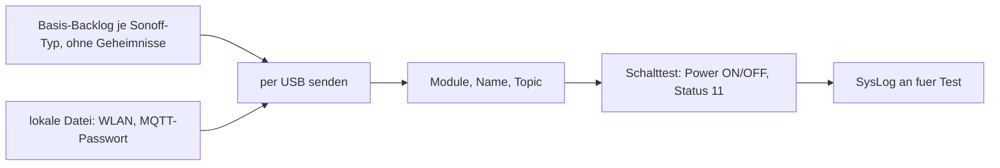

# Plan: Tasmota auf offizielle Fertig-Images umstellen

**Status:** Entwurf v1 (2026-11-11) — analog zu
[`espeasy-fertig-images.md`](espeasy-fertig-images.md). Recherche der
Release-Assets erledigt, Prüfpunkte in Abschnitt 6.

**Umfang:** Tasmota nur für **Schaltgeräte (Sonoff Basic/S20/POW/Dual)**,
**keine Sensoren**. Die Wemos-Sensorvariante (`wemos_user_config_override.sh`,
`switch_wemos.sh`, `Config_wemos_sml.dmp`) entfällt ersatzlos.

---

## 0. Sofort-Befund (vor der Umsetzung) — T-S0

Im **öffentlichen** Repo stehen Zugangsdaten im Klartext:

| Datei | Inhalt |
|---|---|
| [`configs/tasmota/set_config_global.sh`](../configs/tasmota/set_config_global.sh), [`set_config_home.sh`](../configs/tasmota/set_config_home.sh) | MQTT-Benutzer und **MQTT-Passwort** |
| [`configs/tasmota/openandhome/set_config.sh`](../configs/tasmota/openandhome/set_config.sh) | SSID und **Passwort des Installationsnetzes** |
| [`build/Tasmota/myfiles/*user_config_override*`](../build/Tasmota/myfiles/) | `STA_SSID1`/`STA_PASS1` (Installationsnetz), `MQTT_PASS` |

**Maßnahmen:** MQTT-Passwort und Passwort des Installationsnetzes ändern;
Werte aus dem Repo entfernen und künftig aus einer lokalen Datei außerhalb des
Repos lesen (`~/.config/openandhome/tasmota.env`, Rechte 600); optional
Historie bereinigen wie beim WLAN-Schlüssel (`git filter-repo --replace-text`).

---

## 1. Ist-Zustand

| Bereich | Heute |
|---|---|
| Firmware | Eigenbuilds per PlatformIO ([`build_release.sh`](../build/Tasmota/build_release.sh)): `tasmota-lite`, `tasmota-minimal` (OTA-Zwischenschritt), `tasmota-DE`; Ablage in `build/Tasmota/releases/` (25 Dateien, 12,5 MB) |
| Voreinstellungen | einkompiliert über [`user_config_override.h`](../build/Tasmota/myfiles/user_config_override.h) |
| Konfiguration nach dem Flashen | HTTP-Kommandos per `wget` ([`configs/tasmota/`](../configs/tasmota/)): Module (aus dem Namen: POW=6, S20=8, Basic=1, Dual=5), MQTT, Hostname, DeviceName, FriendlyName, Rule1 (täglicher Neustart), SetOption41/53, FullTopic |
| OTA | `OTA_URL` zeigt auf `github.com/…/blob/master/…bin` — **liefert HTML statt Firmware, OTA kann so nie funktioniert haben** |
| Lokales Quell-Repo | `build/Tasmota/Tasmota/` (eingebettetes Repo, nur noch lokal, ignoriert) |

**Einkompilierte Voreinstellungen** → künftig als Kommandos:

| Option | Wert | Tasmota-Kommando |
|---|---|---|
| Sprache | de_DE | nur über Image-Wahl (`tasmota-DE.bin`) |
| Modul | Sonoff S2X / Basic / POW / Dual | `Module <n>` (bzw. `Template`, TP-6) |
| MQTT | aus beim Start, Host `openandhome-server`:1883, User `openhabian`, Power-Retain an | `SetOption3 0`, `MqttHost`, `MqttPort`, `MqttUser`, `MqttPassword` (aus lokaler Datei), `PowerRetain 1` |
| Topics | FullTopic `%prefix%/%topic%/<Name>/`, Topic `schaltsteckdosen`, GroupTopic `sonoffs` | `FullTopic`, `Topic`, `GroupTopic` |
| Telemetrie | 600 s | `TelePeriod 600` |
| Syslog | Host `openandhome-server1`:514, Level aus | `LogHost`, `LogPort`, `SysLog 0` |
| Zeit | NTP fritz.box / de.pool.ntp.org; Zone 99 mit DST/STD; Lat/Long 49.8667/10.3333 | `NtpServer1..3`, `Timezone 99`, `TimeDST`, `TimeSTD`, `Latitude`, `Longitude` |
| Verhalten | PowerOnState 3, LedState 1, SaveData 10, SwitchMode TOGGLE, EnergyRes 3 | `PowerOnState 3`, `LedState 1`, `SaveData 10`, `SwitchMode 0`, `EnergyRes 3` |
| Netz | Gratuitous ARP 115 s, Hostname/IP in GUI | `SetOption41 115`, `SetOption53 1` |
| Regel | täglicher Neustart | `Rule1 on Time#Minute=345 do restart 1 endon` (war deaktiviert: `Rule1 off`) |
| WLAN-Setup | WIFI_MANAGER | `WifiConfig 2` |

## 2. Ziel und Anforderungen (analog ESPEasy)

1. **Kein Eigenbuild** — offizielle Images von
   `https://github.com/arendst/Tasmota/releases` (SHA256-Digest per API).
2. **Stable/Devel** wie bei ESPEasy: Downloads nur auf `devel`, Merge nach
   bestandenem 24h-Test.
3. **Konfiguration komplett per Kommando** (Tasmota kann das vollständig),
   Standardweg **USB** (serielle Konsole) — keine Formular-Rundläufe nötig.
4. **Zugangsdaten nie im Repo** (T-S0), WLAN/MQTT-Passwort aus lokaler Datei.
5. **24h-Test mit Syslog 192.168.9.4**, Name im Test `Testbox<n>`, Teststart
   und -ende im Werkstatt-Tool.

## 3. Image-Wahl (Release v16.0.0, 2026-10-16)

| Gerät | Image | Prüfung |
|---|---|---|
| Sonoff Basic/S20/Dual | **`tasmota-DE.bin`** (deutsch, 667 kB), falls es auf das Gerät passt; sonst **`tasmota-lite.bin`** wie bisher | TP-1 |
| Sonoff POW (Energiemessung) | `tasmota-DE.bin` — Energiemessung in `lite` prüfen | TP-1 |
| OTA-Zwischenschritt bei 1 MB | `tasmota-minimal.bin.gz` | nur falls T-E1 = OTA erlaubt |

Sensor-, Display- und SML-Images werden nicht benötigt.

## 4. Konfiguration: Basis-Backlog statt Override-Header

- Je Sonoff-Typ eine Textdatei `configs/tasmota/basis/<typ>.backlog`
  (Tabelle in Abschnitt 1, ohne Passwörter), per USB gesendet.
- **Ausgelieferte Geräte sichern** mit `decode-config` (offizielles
  Tasmota-Tool, gibt die Konfiguration als **Backlog-Kommandos** aus, TP-4).
- **Prüfung:** Relais per `Power ON`/`Power OFF` schalten und Zustand
  zurücklesen (`Status 11`), beim POW zusätzlich Energiewerte (`Status 8`).
  Kein eigenes Dashboard — die Tasmota-Weboberfläche genügt.

## 5. Werkzeuge

| Werkzeug | Erweiterung |
|---|---|
| [`tools/bin/espeasy_download.py`](../tools/bin/espeasy_download.py) | Klasse `tasmota` (Repo `arendst/Tasmota`, Assets aus Abschnitt 3) → `configs/tasmota/` + `readme_image.txt` |
| neu `tools/bin/tasmota_testbox.py` | `aufsetzen` / `pruefen` / `beenden` wie ESPEasy: Firmware erkennen (Antwort auf `Status 2`), Sicherung, Flashen, Basis-Backlog, Name `Testbox<n>`, Schalttest, `LogHost 192.168.9.4` + `SysLog 2`; Ende: `SysLog 0`, Auslieferungsname, optional WLAN löschen, Protokoll |
| [`tools/ohwerkstatt/oh_werkstatt.sh`](../tools/ohwerkstatt/oh_werkstatt.sh) | erkennt ESPEasy oder Tasmota am USB und ruft das passende Skript; Menüpunkte 1–3 bleiben gleich |
| `configs/tasmota/*.sh` (wget) | ersetzt durch Backlog-Dateien; danach löschen |
| `build/Tasmota/` | nach erfolgreichem Test komplett löschen (OTA-URL war ohnehin defekt) |

## 6. Prüfpunkte (Testgerät Sonoff nötig)

| Nr. | Prüfpunkt | So prüfen |
|---|---|---|
| TP-1 | Flash-Größe der Sonoff-Geräte; passt `tasmota-DE.bin`, hat `lite` die POW-Energiemessung? | `esptool flash_id`, `Status 4`, Testflash |
| TP-4 | `decode-config` an einem ausgelieferten Sonoff | `decode-config -s <ip> --output-format cmnd` |
| TP-5 | Exakte Kommandos für „WLAN löschen" (Teardown) und WLAN-Manager-Start | Testgerät: `SSId1`/`Password1`, `WifiConfig 2`, `Reset`-Varianten |
| TP-6 | Sind die Modulnummern aus `set_config_global.sh` (6/8/1/5) in v16 noch gültig? | Tasmota-Doku „Modules", Testgerät |

## 7. Umsetzungsschritte

1. **T-S0** Zugangsdaten ändern, aus Repo entfernen, lokale `tasmota.env`.
2. **T-R1** Prüfpunkte TP-1, TP-4 … TP-6.
3. **T-D1** Download-Skript um Tasmota erweitern, Images `v16.0.0` auf `devel`.
4. **T-B1** Basis-Backlog je Sonoff-Typ (`configs/tasmota/basis/`).
5. **T-W1** `tasmota_testbox.py` + Werkstatt-Menü (Firmware-Erkennung).
6. **T-T1** 24h-Test je Sonoff-Typ, Merge `devel` → `master`.
7. **T-C1** Aufräumen: `build/Tasmota/`, `configs/tasmota/*.sh`, `Config_wemos_sml.dmp`.

## 8. Entscheidungen

| Nr. | Frage | Vorschlag |
|---|---|---|
| T-E1 | OTA-Updates beim Kunden zulassen? | nein, `OtaUrl` leer (Updates nur in der Werkstatt) |
| T-E2 | Englische Oberfläche, falls `tasmota-DE` nicht passt (`lite`)? | ja |
